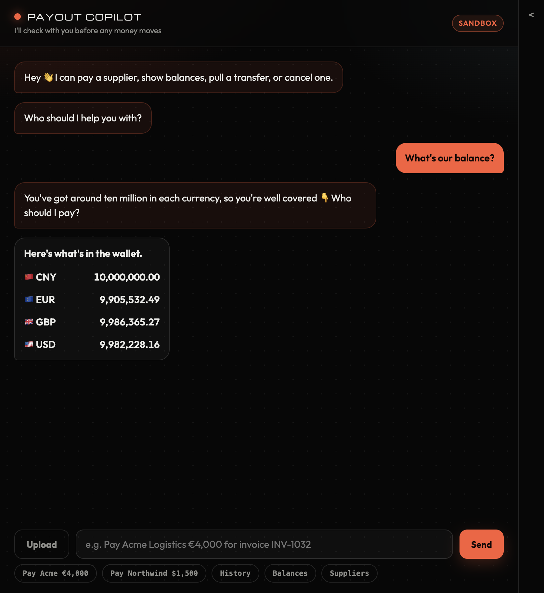
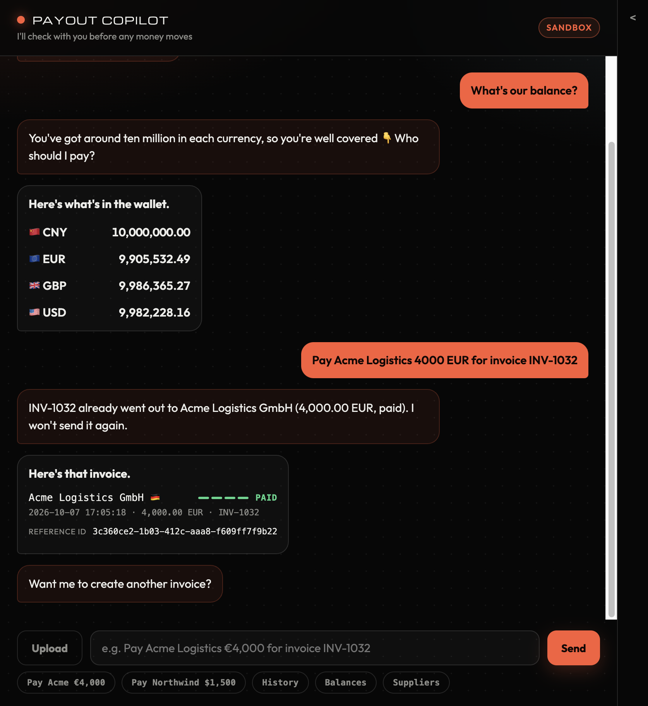
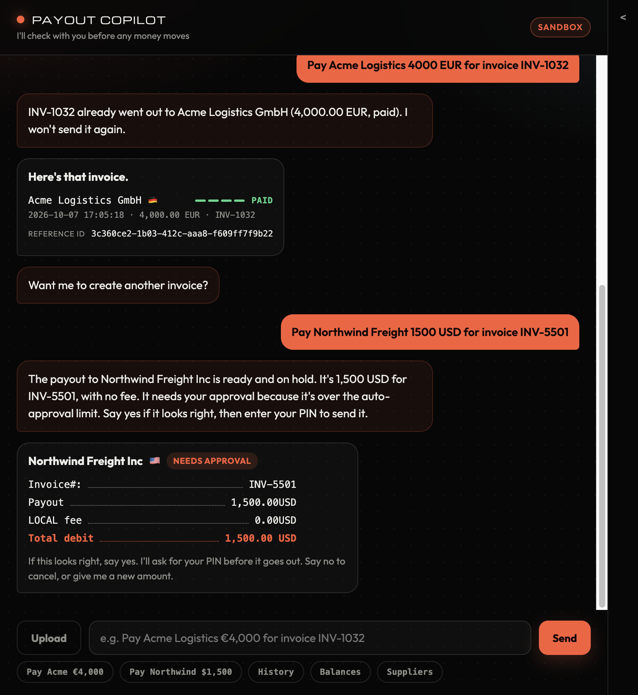
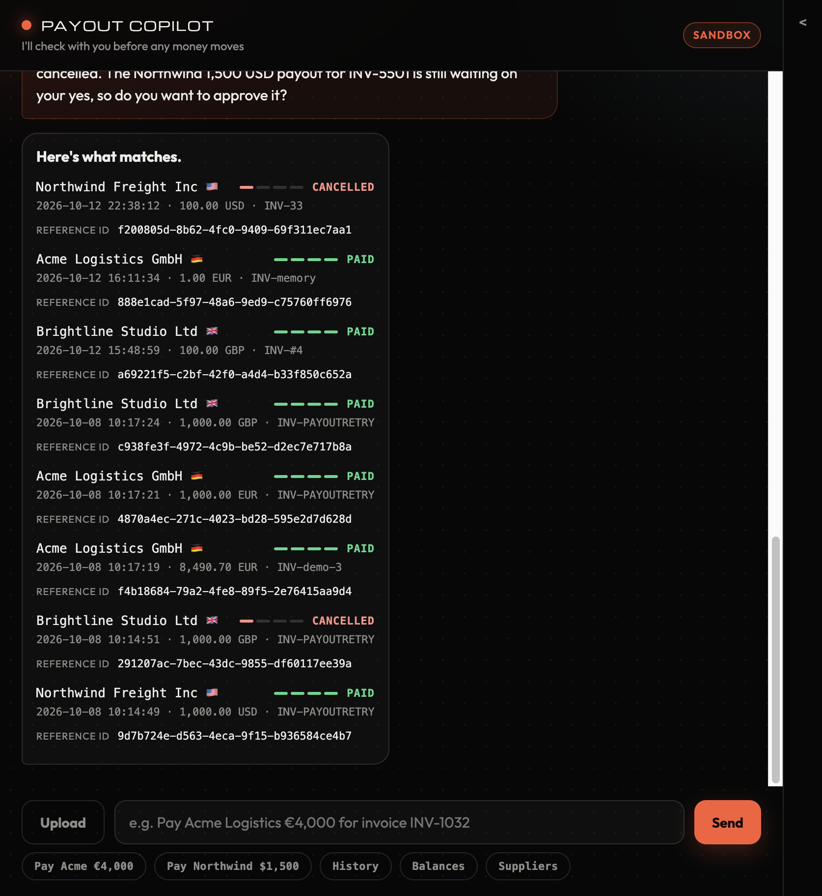
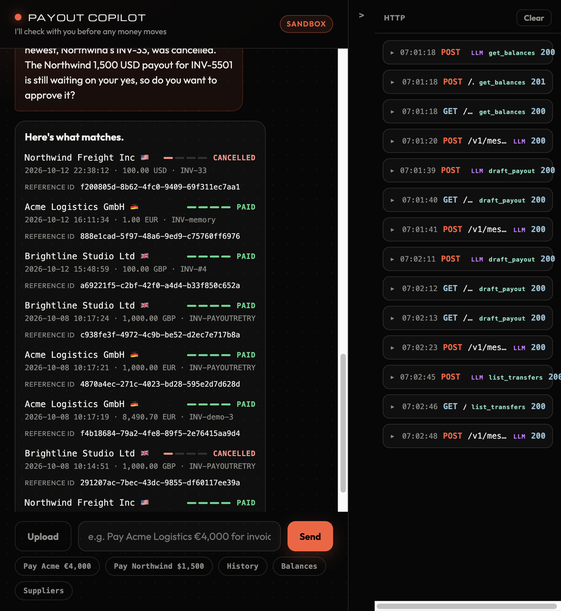

# Payout Copilot

A chat agent for finance teams that pays suppliers through Airwallex. Type a payout in plain language, or drop in PDF invoices. The agent drafts a priced receipt, waits for **yes**, then a PIN, and only then sends it.

Built against the **real Airwallex sandbox**. A failed call is shown, not mocked.

What it does:

- **Single and batch payouts.** One sentence can hold several payouts. Each receipt gets its own yes, then one PIN sends the whole batch.
- **PDF invoices.** Upload or drag in up to 6 invoices. It reads the supplier, total, currency, and invoice number, then drafts them.
- **Live status.** Each transfer shows a progress rail: PROCESSING, SENT, PAID, or CANCELLED.
- **History.** Filter by date ("transactions from 10/07/2026"), supplier, status, or reference.
- **Cancel.** "Cancel the last two" shows exactly which transfers, then cancels only after yes.
- **HTTP console.** A side panel shows every Airwallex and Claude call, with secrets redacted.

---

## Requirements

- Python **3.9 or newer** (tested on 3.9.6)
- An **Airwallex sandbox** account: Client ID and API key
- An **Anthropic API key** for Claude
- macOS, Linux, or Windows. On Windows, use `.venv\Scripts\python` wherever this file says `.venv/bin/python`.

## Quick start

```bash
git clone https://github.com/mreddiedu/airwallex-agent-demo.git
cd airwallex-agent-demo
python3 -m venv .venv
.venv/bin/pip install -r requirements.txt
cp .env.example .env            # then fill in the three keys, see below
.venv/bin/python scripts/test_core.py    # offline, no keys needed
.venv/bin/python scripts/preflight.py    # live and read-only, needs keys
.venv/bin/python -m uvicorn app.main:app --reload --port 8000
```

Open [http://127.0.0.1:8000](http://127.0.0.1:8000).

### 1. Get sandbox credentials

Sign up at [sandbox.airwallex.com](https://sandbox.airwallex.com), then go to **Account → Developer → API keys** and generate a Client ID and API key.

> If you create a second business in the web app, name it `New Business Sandbox` or `Sandbox Business`, or onboarding stays *In review*.

Get an Anthropic key at [console.anthropic.com](https://console.anthropic.com).

### 2. Configure `.env`

| Key | Required | What it is |
| --- | --- | --- |
| `AWX_CLIENT_ID` | yes | Airwallex sandbox Client ID |
| `AWX_API_KEY` | yes | Airwallex sandbox API key |
| `AWX_BASE_URL` | no | Defaults to `https://api.sandbox.airwallex.com`. Leave it on the sandbox. |
| `ANTHROPIC_API_KEY` | yes | Claude key |
| `ANTHROPIC_MODEL` | no | Defaults to `claude-sonnet-5-5` |
| `APPROVAL_PIN` | no | 4-digit PIN asked before any send. Default `1234` |
| `AUTO_APPROVE_LIMIT_USD` | no | Default `0`, so every payout needs a person. Leave it. |
| `PREFLIGHT` | no | `0` skips the live check the server runs on start |

`.env` is gitignored. Keys never go in code.

### 3. Check the sandbox before you use it

```bash
.venv/bin/python scripts/preflight.py
```

This is read-only. It checks login, balances in **EUR, USD and GBP**, one transfer read, bank-detail validation for each supplier (this creates nothing), and a one-token Claude call. Every line should say `PASS`.

The three suppliers are paid in EUR, USD, and GBP. If a currency shows `0`, payouts to that supplier are refused for insufficient funds.

- Many sandbox accounts start with test balances.
- `scripts/setup_sandbox.py` finds or creates a USD Global Account and **simulates a USD deposit** (default 25,000). Run it if USD is empty. It deposits again every time it runs.
- For EUR or GBP, fund that currency in the sandbox web app first.

### 4. Run

```bash
.venv/bin/python -m uvicorn app.main:app --reload --port 8000
```

On every start the server runs the offline tests (it won't start if one fails), then the live preflight in the background. The terminal shows `core tests passed`, then `preflight passed` or `preflight FAILED` with the reason.

---

## Setting this up with an AI coding agent

This repo is written to be set up by an agent such as Cursor, Claude Code, or Codex. [AGENTS.md](AGENTS.md) has the rules it should follow. Paste this into your agent:

> Set up this repo so I can run it locally. Follow README.md "Quick start" exactly. Create `.venv` with Python 3.9+, install `requirements.txt`, and copy `.env.example` to `.env`. Then stop and ask me for `AWX_CLIENT_ID`, `AWX_API_KEY`, and `ANTHROPIC_API_KEY`. Do not invent them, print them, or commit `.env`. Run `scripts/test_core.py` and show me the result. When I've added keys, run `scripts/preflight.py`, then start the server on port 8000. Never approve a payout, enter a PIN, cancel a transfer, or run `setup_sandbox.py` (it deposits money) unless I ask.

Cursor also reads `.cursor/rules/` for project conventions. `.cursor/mcp.json` points at Airwallex's docs and developer MCP servers. They're an optional editor aid, and the app never calls them.

---

## Screenshots

Real sandbox data. Nothing below was approved, so no money moved.

**1. Ask for balances.** Read-only lookup against the live wallet.



**2. Duplicate guard.** An invoice that already went out is refused and shown instead.



**3. Draft a payout.** The receipt is held. Nothing is sent until you say yes and enter the PIN.



**4. History.** Status rails for every transfer, read from Airwallex.



**5. HTTP console.** Every LLM and Airwallex call, with the tool that made it.



## Try it

| Input | What should happen |
| --- | --- |
| `Pay Acme Logistics €4,000 for invoice INV-1032` | Priced with the SWIFT fee, held for approval |
| `Send Brightline Studio £1,200 for the March retainer` | Held. First-ever payment to that supplier |
| `Pay Northwind $900 invoice NW-77` | LOCAL rail, no fee, held |
| `Pay Acme €500 for INV-50 and Northwind $300 for INV-51` | Two receipts. Yes on each, then one PIN |
| `Pay the supplier some money` | Asks who and how much. Nothing drafted |
| `Pay Globex $5,000` | Blocked. Not in the supplier directory |
| `Pay Acme $4,000` | Blocked. Acme receives EUR, not USD |
| `Pay Acme €999,999 for INV-1` | Blocked. More than the wallet holds |
| `Show me transactions from 10/07/2026` | Every transfer that day, however many |
| `What's our balance?` / `Who can I pay?` | Balance or supplier card |

The chips under the input go through Claude like typed text. **Pay Acme** and **Pay Northwind** fill in the smallest `INV-n` that supplier has never used, cancelled ones included, so each click is a fresh invoice.

Say **yes**, then the PIN (`APPROVAL_PIN`, default `1234`). Three wrong PINs lock the account, counted across drafts and restarts. Triple-click the title to unlock. **No** or **cancel** sends nothing.

**Upload** or drop PDF invoices onto the chat, up to 6 at a time. Nine samples are in [`samples/invoices/`](samples/invoices), three per supplier. `samples/make_invoices.py` regenerates them with no extra packages. A file the reader can't read, or one from a supplier not on file, is named and left out; the rest still go through. Bank details printed on an invoice are ignored. They always come from the supplier directory.

Several payouts in one message become a queue. If any one is blocked or repeats an invoice, none are held. If one fails while sending, the rest stay unsent and waiting.

To stop an open transfer, say so in plain language:

| Input | What should happen |
| --- | --- |
| `Cancel the latest transfer` | The newest open transfer, held until you say yes |
| `Cancel the last two` | Both, in one card. One yes cancels each |
| `Cancel all Acme transfers` | Every open Acme transfer. A single vague match asks which one |
| `Cancel INV-1044` | That invoice, if it is still open. Paid transfers are refused |

Invoice numbers match whole: `Cancel INV-1` never picks INV-1032.

---

## LLM and tools

Claude interprets the message. Code decides whether money can move. A person approves before it does.

- **Model:** `ANTHROPIC_MODEL`, default Claude Sonnet 5.5, called through [POST /v1/messages](https://platform.claude.com/docs/en/api/messages/create) with tool use.
- **Loop:** `app/agent.py`. Up to 6 tool rounds per message, plus one per uploaded invoice. If it runs out of rounds, nothing it drafted is held.
- **Prompt:** `SYSTEM_PROMPT` in `app/agent.py`, with the supplier list and the local time.
- **Memory:** the last 10 turns of the chat. Cards are stored as one line, not their rows.
- **Fallback:** if Claude is unreachable, simple shortcuts still answer balances, suppliers, history, and cancels, and say Claude is offline.

The model can call six tools (`app/tools.py`). None of them can send, cancel, or simulate.

| Tool | Airwallex call | Returns |
| --- | --- | --- |
| `get_balances` | `GET /balances/current` | Wallet by currency |
| `list_suppliers` | none | The vetted directory in `app/suppliers.py` |
| `list_transfers` | `GET /transfers`, paged | History. A date window returns every match |
| `get_transfer` | `GET /transfers/{id}` | One transfer |
| `draft_payout` | `GET /transfers` once per turn, `GET /balances/current` | A priced receipt, held. Not sent |
| `draft_cancel` | `GET /transfers` | The matching open transfers. Not cancelled |

The model never picks LOCAL or SWIFT, sets a fee, decides whether approval is needed, sees bank details, or calls `transfers/create`. Those live in `app/policy.py` and the approve routes. In the HTTP console, model calls carry an `LLM` label and tool calls a green tool label.

---

## How it works

```
plain language, or up to 6 PDFs
  → Claude calls tools (balances, suppliers, history, one transfer)
  → draft_payout prices a receipt in code, or draft_cancel lists matches
  → you say yes to each receipt, then enter one PIN
  → code checks every fingerprint, then POST /transfers/create, in order
  → chat shows Approved, the reference id, and the new balances
  → sandbox waits 45s (120s for Acme), marks it SENT, waits 15s, marks it PAID

"cancel the latest Acme transfer"
  → Claude calls draft_cancel
  → code matches open transfers from GET /transfers
  → you say yes
  → POST /transfers/{id}/cancel for each shown id
  → chat shows the balance those funds return to
```

### The controls

- **Every payout needs a yes and a PIN.** `AUTO_APPROVE_LIMIT_USD=0`. Three misses lock the account. A new draft doesn't reset the count, and neither does a restart.
- **Approval is tied to the receipt on screen** (payee, amount, currency, fee, rail, reference). A mismatch returns 409 and sends nothing.
- **Unclear requests get a question**, not a guess.
- **Bank details come only from the supplier directory**, never from the model or a PDF.
- **One `request_id` per plan**, checked with `GET /transfers` before send, so a retry can't pay twice. An invoice already paid to that supplier is refused at draft and again at approve.
- **A cancel needs a yes.** The ids are chosen in code from the live list. Yes cancels only that set. `update_unsupported` is shown, not hidden.

### Files

| File | Role |
| --- | --- |
| `app/main.py` | Routes, PIN gate, approval, startup checks |
| `app/agent.py` | The only LLM call. Tool loop and system prompt |
| `app/tools.py` | The six tools and their input checks. No send, no cancel |
| `app/policy.py` | Every decision about moving money. Deterministic |
| `app/airwallex.py` | Sandbox client. Token cache, typed errors |
| `app/suppliers.py` | Vetted bank details. The model never invents an account |
| `app/invoice_reader.py` | PDF text to supplier, amount, currency, invoice number. Never guesses a field |
| `app/invoices.py` | Repeat-invoice check and the next free `INV-n` |
| `app/cancel.py` | Matches a cancel request to real transfers. No API calls |
| `app/sandbox_progress.py` | PROCESSING → 45s (120s for Acme) → SENT → 15s → PAID. Sandbox only |
| `app/httplog.py` | Redacted request log for the HTTP console |
| `app/models.py` | Request and plan types |
| `app/static/index.html` | The chat page |
| `scripts/test_core.py` | 43 offline checks. Runs on every server start |
| `scripts/preflight.py` | Live, read-only sandbox and Claude check |
| `scripts/setup_sandbox.py` | Optional. Creates a USD Global Account and deposits test funds |
| `samples/` | Sample invoice PDFs and the script that makes them |

---

## Airwallex APIs

Base URL [https://api.sandbox.airwallex.com](https://www.airwallex.com/docs/api/getting_started). Every path below is under `/api/v1`. The bearer token comes from login and is reused until `expires_at`.

| Method and path | Used for |
| --- | --- |
| [POST /authentication/login](https://www.airwallex.com/docs/api/authentication/api_access_token/login) | Bearer token. Headers `x-client-id` and `x-api-key`, no body |
| [GET /balances/current](https://www.airwallex.com/docs/api/core_resources/balances/current) | Balances in chat, and the affordability check |
| [GET /global_accounts](https://www.airwallex.com/docs/api/core_resources/global_accounts) | Setup only. Find the account to fund |
| [POST /global_accounts/create](https://www.airwallex.com/docs/api/core_resources/global_accounts) | Setup only, if no Global Account exists yet |
| [POST /beneficiaries/validate](https://www.airwallex.com/docs/api/payouts/beneficiaries/validate) | Check bank details before creating a payee. Also in preflight |
| [POST /beneficiaries/create](https://www.airwallex.com/docs/api/payouts/beneficiaries/create) | Create the payee on the first approved payout |
| [POST /transfers/create](https://www.airwallex.com/docs/api/payouts/transfers/create) | The only call that moves money. Requires the approved fingerprint |
| [GET /transfers](https://www.airwallex.com/docs/api/payouts/transfers/list) | History, repeat-invoice check, and `request_id` lookup |
| [GET /transfers/{id}](https://www.airwallex.com/docs/api/payouts/transfers/retrieve) | Status of a transfer on screen |
| [POST /transfers/{id}/cancel](https://www.airwallex.com/docs/api/payouts/transfers/cancel) | Cancel an open transfer after yes. One call per transfer |
| [POST /simulation/deposit/create](https://www.airwallex.com/docs/api/simulation/deposits/create) | Setup script only. Reports `PENDING` but posts immediately |
| [POST /simulation/transfers/{id}/transition](https://www.airwallex.com/docs/developer-tools/sandbox-environment/payouts/simulate-transfer-status-transition) | Sandbox timer: PROCESSING → SENT → PAID. Body field is `next_status` |

Routes this app serves:

| Method and path | Used for |
| --- | --- |
| `GET /` | Chat page |
| `GET /api/context` | Lock state and any plan still waiting. Doesn't call Airwallex |
| `GET /api/balances` | Live wallet, for the before-and-after lines |
| `GET /api/next-invoice` | Smallest INV-n a supplier has never used. Fills the pay chips |
| `GET /api/http`, `POST /api/http/clear` | Redacted calls for the HTTP console |
| `POST /api/invoices/read` | Up to 6 PDFs. The four fields per file and one payout message. Reads only |
| `POST /api/chat` | Claude with tools. Never sends money |
| `POST /api/approve` | Send one plan after the PIN, if the fingerprint still matches |
| `POST /api/approve-batch` | One PIN for a queue. Every fingerprint is checked before the first send |
| `POST /api/reject` | Drop the pending plans |
| `POST /api/cancel-transfers` | Cancel the transfers just shown, after yes. `confirm: false` drops them |
| `POST /api/admin/reset` | Clear a PIN lock. Bound to the title triple-click |
| `GET /api/transfer/{id}` | Status of one transfer. Resumes the sandbox timer |
| `GET /api/transfers/recent` | Status of several on screen, in one `GET /transfers` |

The page polls only while a transfer on screen can still move, timed to the sandbox countdown. It stops at a final status, or after 15 checks with no change.

---

## Tests

```bash
.venv/bin/python scripts/test_core.py
```

43 checks, offline. No keys, no LLM call, no network.

| Group | What it proves |
| --- | --- |
| Guardrails | Unknown payee, wrong currency, no invoice, over balance, bad amount; fees; fingerprint |
| Approval and PIN | Wrong PIN sends nothing; 3 misses lock across drafts and restarts; 409 on a changed plan; one-PIN batch stops at the first failure |
| No double pay | `request_id` retry adopts; paid invoice refused at approve; second click 409 |
| Cancel | Whole-invoice match; latest by time; stale id ignored; yes cancels only the set shown |
| Tools | Six tools, none reaches create, cancel, or simulation; errors go back to the model; round cap; a 101-transfer day returns 101 |
| Sandbox timer | 45s in PROCESSING (120s for Acme), then 15s to PAID. Resumes after a reload |
| Invoice upload | Three invoice layouts; glued labels; unknown supplier and missing total reported; 6-file limit; non-PDF refused |

## Troubleshooting

| Symptom | Fix |
| --- | --- |
| `Server not started` on launch | An offline check failed. Run `scripts/test_core.py` to see which |
| `preflight FAILED` | The terminal names the failing check. Usually a wrong key or an empty currency |
| `proxy_blocked` or `ProxyError: 403` on login | A sandboxed shell (for example Cursor's agent shell) injected a proxy. Start the server from your own terminal |
| `Address already in use` | Another server holds port 8000. Stop it, or use `--port 8001` |
| `insufficient funds` on a receipt | That currency is empty in the sandbox. See step 3 |
| Account locked after 3 PINs | Triple-click the "Payout Copilot" title |

## Demo fallback

If live calls fail during a demo, `scripts/test_core.py` shows every guardrail offline. The blocked and clarifying rows in "Try it" never reach Airwallex.
